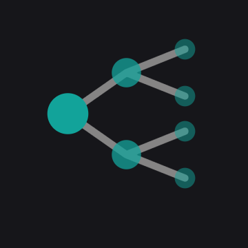

<div align="center">
  
  <h1>Cascade: Hoax Propagation Simulator</h1>
  <p><b>Simulasikan bagaimana sebuah rumor menyebar lewat jaringan sosial dan bandingkan intervensi seperti<br/>
  klarifikasi dini, peningkatan literasi, atau pemblokiran penyebar utama. Sintetis dan bisa direproduksi.</b></p>

  <a href="https://github.com/nekonaru/cascade/releases"></a>
  <a href="https://github.com/nekonaru/cascade/actions/workflows/ci.yml"></a>
  
  
  
  
</div>

<br />

[English](README.md) | **Bahasa Indonesia**

> [!NOTE]
> Cascade berjalan di atas jaringan dan akun yang sepenuhnya sintetis. Tidak ada data pengguna, pesan, atau platform nyata di proyek ini, dan hasil simulasinya bukan prediksi tentang dunia nyata.

---

## Daftar Isi

- [Tentang](#tentang)
- [Fitur](#fitur)
- [Kebutuhan](#kebutuhan)
- [Instalasi](#instalasi)
- [Penggunaan](#penggunaan)
- [Konfigurasi](#konfigurasi)
- [Struktur Proyek](#struktur-proyek)
- [Pengembangan](#pengembangan)
- [Testing](#testing)
- [Continuous Integration](#continuous-integration)
- [FAQ](#faq)
- [Penulis](#penulis)
- [Disclaimer](#disclaimer)
- [Lisensi](#lisensi)

---

## Tentang

**Cascade** adalah simulator berbasis agen untuk penyebaran rumor di jaringan sosial sintetis. Satu pesan (hoaks) disebar dari satu atau lebih akun, lalu simulasi menunjukkan seberapa jauh dan seberapa cepat pesan itu menyebar. Kamu bisa membandingkan intervensi secara kuantitatif: waktu klarifikasi, peningkatan literasi digital, atau pemblokiran akun dengan derajat tertinggi sejak awal.

> _"Satu pesan, ribuan kotak masuk, dan pertanyaan yang selalu diajukan moderator: apa yang bisa menghentikannya?"_

---

## Fitur

### Jaringan

| Fitur | Deskripsi |
|-------|-----------|
| **Empat topologi** | Erdos-Renyi, Watts-Strogatz, Barabasi-Albert, dan Stochastic Block Model (echo chamber) |
| **Generasi deterministik** | Setiap generator menerima seed `StableRNG` eksplisit; seed sama, graph sama |
| **Deteksi komunitas** | Blok SBM atau connected components dipakai untuk seeding per komunitas |

### Model

| Fitur | Deskripsi |
|-------|-----------|
| **Empat state agen** | Susceptible, Believer, Skeptic (tahu tapi tidak percaya), Recovered |
| **Skeptisisme heterogen** | Skeptisisme tiap agen diambil dari Beta(2, 5), ditambah literacy boost |
| **Lupa** | Believer berhenti menyebar dengan laju yang bisa diatur |
| **Stream RNG eksplisit** | Stream terpisah untuk generasi jaringan, pemilihan seed, dan model |

### Intervensi

| Fitur | Deskripsi |
|-------|-----------|
| **Klarifikasi terlambat vs dini** | Klarifikasi pada langkah `t` mengubah sebagian Believer yang aktif saat itu |
| **Literacy boost** | Menaikkan skeptisisme seluruh populasi sebelum simulasi mulai |
| **Block top-k** | Memblokir akun seed dengan derajat tertinggi sebelum cascade dimulai |
| **Strategi seed** | Acak, hub (derajat tertinggi), atau per komunitas |

### Analisis

| Fitur | Deskripsi |
|-------|-----------|
| **Replikasi Monte Carlo** | Runner replikasi bawaan dengan rata-rata, std, dan CI 95% (distribusi t) |
| **Metrik** | Jangkauan akhir, jumlah ever-believer, puncak Believer aktif, waktu menuju puncak, pertumbuhan awal |
| **Sweep parameter** | Grid sweep dengan heatmap rata-rata jangkauan akhir |
| **Ekspor** | History dan metrik sebagai CSV dan JSON, gambar sebagai PNG, animasi sebagai GIF |

### Engineering

| Fitur | Deskripsi |
|-------|-----------|
| **Run reproducible** | Seed identik menghasilkan history identik; diuji di test suite |
| **Core loop type-stable** | Loop utama memakai array bertipe konkret, tanpa field `Any` |
| **Konfigurasi TOML** | `config/default.toml` menjalankan simulasi penuh lewat `scripts/run_config.jl` |
| **Skrip benchmark** | `scripts/benchmark.jl` mengukur run 10.000 node x 200 langkah |

---

## Kebutuhan

| Dependency | Versi Minimum | Catatan |
|------------|---------------|---------|
| **Julia** | 1.10 (LTS) | Dibutuhkan untuk instalasi atau build dari source |
| **Git** | apa pun | Dibutuhkan untuk clone repositori |

> [!TIP]
> Kalau kamu hanya ingin memakai package-nya, tidak perlu build apa-apa. Tambahkan ke proyek Julia kamu dengan `Pkg.add` dan package manager yang mengunduh dependency-nya.

### Belum pernah pakai terminal? Mulai dari sini

<details>
<summary><b>Cara membuka terminal</b></summary>

1. **Windows:** tekan tombol **Windows**, ketik `PowerShell`, tekan **Enter**
2. **macOS:** buka **Terminal** dari Applications > Utilities
3. **Linux:** buka terminal emulator kamu (misalnya `Ctrl+Alt+T`)

Semua perintah di panduan ini diketik di jendela itu, lalu tekan **Enter**.

</details>

---

## Instalasi

### Opsi A: Pakai sebagai package Julia

Tambahkan Cascade ke proyek Julia kamu langsung dari GitHub:

```julia
using Pkg
Pkg.add(url = "https://github.com/nekonaru/cascade.git")
```

Lalu:

```julia
using Cascade
spec = NetworkSpec(:barabasi_albert, 1000; k = 3)
sim = run_simulation(spec, CascadeParams(beta = 0.08); seed = 42, steps = 200)
final_reach(sim)
```

### Opsi B: Build dari source (untuk development / membaca atau mengubah kode)

#### 1. Ambil kode proyek

<details>
<summary><b>Saya sudah punya Git</b></summary>

```bash
git clone https://github.com/nekonaru/cascade.git
cd cascade
```

</details>

<details>
<summary><b>Saya belum punya Git</b></summary>

1. Buka halaman repositori di GitHub
2. Klik tombol hijau **`Code`**, pilih **`Download ZIP`**
3. Ekstrak ZIP ke folder pilihan kamu
4. Di terminal, masuk ke folder hasil ekstrak, misalnya:

```bash
cd Downloads/cascade-main
```

</details>

#### 2. Install dependency dan verifikasi

```bash
julia --project=. -e 'using Pkg; Pkg.instantiate()'
julia --project=. -e 'using Pkg; Pkg.test()'
```

> [!IMPORTANT]
> Test suite harus selesai dengan `Test Summary: Cascade | Pass` dan tanpa kegagalan atau error.

#### 3. Jalankan skrip demo

```bash
julia --project=. scripts/run_single.jl
julia --project=. scripts/run_config.jl
```

---

## Penggunaan

### Jalankan pertama kali

1. Clone repositori dan instantiate (lihat Opsi B di atas)
2. Jalankan demo single-run: `julia --project=. scripts/run_single.jl`
3. Baca `cascade-history.csv` untuk jumlah state per langkah, atau metrik yang tercetak untuk angka utamanya

> [!NOTE]
> Semua skrip menulis output ke direktori kerja saat ini. Tidak ada file atau gambar yang ditulis di luar direktori itu.

### Pakai sehari-hari

- Jalankan satu simulasi dengan `scripts/run_single.jl` atau dari REPL Julia dengan `run_simulation(...)`
- Reproduksi sebuah studi dari file dengan `scripts/run_config.jl path/to/config.toml`
- Bandingkan strategi seed dengan `scripts/montecarlo.jl` (200 replikasi, random vs hub)
- Bandingkan waktu klarifikasi dengan `scripts/factcheck_comparison.jl` (none vs t = 6, 12, 24)
- Buat ulang gambar README dengan `scripts/make_readme_assets.jl`
- Animasikan cascade kecil dengan `scripts/animate.jl out.gif`
- Cek performa dengan `scripts/benchmark.jl` (10.000 node x 200 langkah)

---

## Konfigurasi

Semua knob ada di file TOML (lihat [`config/default.toml`](config/default.toml)):

| Key | Default | Arti |
|-----|---------|------|
| `network.kind` | `barabasi_albert` | `erdos_renyi`, `watts_strogatz`, `barabasi_albert` atau `sbm` |
| `network.n` | `1000` | Jumlah agen di jaringan |
| `params.beta` | `0.08` | Probabilitas meneruskan pesan ke tiap tetangga Susceptible per langkah |
| `params.forget_rate` | `0.05` | Probabilitas Believer berhenti menyebar per langkah |
| `params.literacy_boost` | `0.0` | Ditambahkan ke skeptisisme tiap agen sebelum t = 0 |
| `params.factcheck_time` | tidak diisi | Langkah saat klarifikasi mendarat; kosong berarti nonaktif |
| `params.factcheck_reach` | `0.7` | Fraksi Believer aktif yang berubah jadi Skeptic lewat klarifikasi |
| `params.block_top_k` | `0` | Blokir k akun seed dengan derajat tertinggi sejak awal |
| `run.seed` | `42` | Seed utama untuk jaringan, seeds, dan model |
| `run.strategy` | `random` | `random`, `hub`, atau `community` |
| `run.m_seeds` | `1` | Jumlah akun Believer awal |
| `run.steps` | `200` | Jumlah langkah simulasi |

---

## Struktur Proyek

```
cascade/
├── src/
│   ├── Cascade.jl         # entry point module dan exports
│   ├── networks.jl        # generator jaringan sintetis (Graphs.jl)
│   ├── model.jl           # state, parameter, aturan transisi per langkah
│   ├── interventions.jl   # strategi pemilihan seed (random / hub / community)
│   ├── experiments.jl     # single run, Monte Carlo, sweep, metrik
│   ├── config.jl          # loader konfigurasi TOML
│   └── plots.jl           # kurva, pita interval, heatmap, animasi GIF
├── test/                  # test suite (networks, model, experiments, io, plots)
├── scripts/               # demo, studi Monte Carlo, benchmark, GIF
├── config/
│   └── default.toml       # contoh konfigurasi
├── docs/
│   └── model.md           # persamaan model dan keputusan desain
├── assets/                # logo dan gambar yang dihasilkan
├── .github/
│   └── workflows/
│       └── ci.yml         # test, ambang coverage, secret scan
├── Project.toml
├── Manifest.toml          # pohon dependensi yang di-pin (dibuat Pkg)
├── LICENSE
├── README.md              # dokumentasi (English)
└── README.id.md           # dokumentasi (Bahasa Indonesia)
```

---

## Pengembangan

### Menambah atau mengubah parameter model

1. Tambahkan field-nya ke `CascadeParams` di `src/model.jl` dengan default
2. Pakai di aturan transisi, `docs/model.md`, dan `config/default.toml`
3. Perluas `test/test_model.jl` dan `test/test_experiments.jl`
4. Update kedua README dan `CHANGELOG.md` / `CHANGELOG.id.md` jika user-visible

> [!WARNING]
> `Manifest.toml` dibuat oleh Pkg dan memang dikomit. Jangan pernah mengeditnya manual; jalankan `julia --project=. -e 'using Pkg; Pkg.resolve()'`.

---

## Testing

Verifikasi sebelum setiap push, harus bersih:

```bash
julia --project=. -e 'using Pkg; Pkg.instantiate(); Pkg.test()'
```

| Check | Requirement |
|-------|-------------|
| `Pkg.test()` | Seluruh suite lolos, tanpa failure atau error |
| Job coverage `ci.yml` | Line coverage `src/` minimal 50% |
| Job secret scan `ci.yml` | gitleaks tidak menemukan secret yang bocor |

---

## Continuous Integration

| Workflow | Tujuan |
|----------|--------|
| `ci.yml` (test) | Test suite di Julia 1.10 dan Julia 1, Ubuntu dan Windows |
| `ci.yml` (coverage) | Menegakkan ambang line coverage di `src/` |
| `ci.yml` (secret-scan) | gitleaks scan seluruh history |

---

## FAQ

<details>
<summary><b>Apakah Cascade memakai data media sosial nyata?</b></summary>

Tidak. Setiap jaringan bersifat sintetis dan setiap agen adalah akun simulasi. Proyek ini dibuat untuk edukasi dan riset pertahanan terhadap disinformasi, bukan untuk menarget komunitas nyata.

</details>

<details>
<summary><b>Kenapa dua run dengan seed yang sama memberikan hasil identik?</b></summary>

Semua randomness mengalir lewat stream `StableRNG` eksplisit. Seed yang sama menghasilkan graph yang sama, seed node yang sama, dan transisi yang sama, itulah yang membuat eksperimen bisa direproduksi.

</details>

<details>
<summary><b>Seberapa akurat hasilnya sebagai prediksi?</b></summary>

Bukan prediksi. Modelnya sengaja sederhana (seperti SIR dengan kelas Skeptic) agar kamu bisa menalar mekanismenya. Perlakukan output sebagai ilustrasi efek jaringan, bukan ramalan untuk sebarang rumor nyata.

</details>

<details>
<summary><b>Bisakah saya menambahkan jaringan sendiri dari file?</b></summary>

Belum. Generator mendukung empat topologi bawaan. Memuat adjacency list dari file adalah kandidat fitur untuk rilis berikutnya.

</details>

---

## Penulis

<div align="center">

| [](https://github.com/nekonaru) |
|:---:|
| **Nicolas Dwi Dharma** |
| [github.com/nekonaru](https://github.com/nekonaru) |

</div>

---

## Disclaimer

Cascade adalah proyek edukasi independen. Proyek ini tidak memodelkan platform nyata, tidak melakukan scraping atau memakai akun dan pesan nyata, dan outputnya tidak boleh dibaca sebagai bukti tentang disinformasi di dunia nyata. Tujuannya adalah literasi sains jaringan dan riset pertahanan.

---

## Lisensi

Didistribusikan di bawah **MIT License**. Lihat [`LICENSE`](LICENSE) untuk informasi lebih lanjut.
