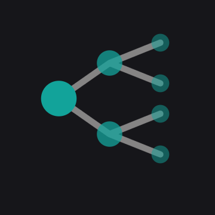

<div align="center">
  
  <h1>Cascade: Hoax Propagation Simulator</h1>
  <p><b>Simulate how a rumor spreads through a social network and compare interventions like<br/>
  early fact-checks, literacy boosts, or blocking the main spreaders. Fully synthetic and reproducible.</b></p>

  <a href="https://github.com/nekonaru/cascade/releases"></a>
  <a href="https://github.com/nekonaru/cascade/actions/workflows/ci.yml"></a>
  
  
  
  
</div>

<br />

**English** | [Bahasa Indonesia](README.id.md)

> [!NOTE]
> Cascade runs on fully synthetic networks and accounts. Nothing in this project is based on real users, messages or platforms, and the results are not predictions about the real world.

---

## Table of Contents

- [About](#about)
- [Features](#features)
- [Requirements](#requirements)
- [Installation](#installation)
- [Usage](#usage)
- [Configuration](#configuration)
- [Project Structure](#project-structure)
- [Development](#development)
- [Testing](#testing)
- [Continuous Integration](#continuous-integration)
- [FAQ](#faq)
- [Author](#author)
- [Disclaimer](#disclaimer)
- [License](#license)

---

## About

**Cascade** is an agent-based simulator for rumor propagation on synthetic social networks. One message (a hoax) is seeded from one or more accounts, and the simulation shows how far and how fast it spreads. You can compare interventions quantitatively: fact-check timing, digital literacy boosts, or blocking the highest-degree accounts up front.

> _"One message, a thousand inboxes, and the question every moderator asks: what stops it?"_

---

## Features

### Networks

| Feature | Description |
|---------|-------------|
| **Four topologies** | Erdos-Renyi, Watts-Strogatz, Barabasi-Albert, and Stochastic Block Model (echo chambers) |
| **Deterministic generation** | Every generator takes an explicit `StableRNG` seed; same seed, same graph |
| **Community detection** | SBM blocks or connected components are used for per-community seeding |

### Model

| Feature | Description |
|---------|-------------|
| **Four agent states** | Susceptible, Believer, Skeptic (informed but unconvinced), Recovered |
| **Heterogeneous skepticism** | Per-agent skepticism sampled from Beta(2, 5), blended with a literacy boost |
| **Forgetting** | Believers stop spreading with a configurable rate |
| **Explicit RNG streams** | Separate streams for network generation, seed selection and the model itself |

### Interventions

| Feature | Description |
|---------|-------------|
| **Late vs early fact-checks** | A fact-check at step `t` converts a fixed fraction of current Believers |
| **Literacy boost** | Raises the skepticism of the whole population up front |
| **Block top-k** | Blocks the highest-degree seed accounts before the cascade starts |
| **Seed strategies** | Random, hub (highest degree), or per-community seeding |

### Analysis

| Feature | Description |
|---------|-------------|
| **Monte Carlo replications** | Built-in replication runner with mean, std and 95% CI (t-distribution) |
| **Metrics** | Final reach, ever-believer count, peak active Believers, time to peak, initial growth |
| **Parameter sweeps** | Grid sweeps with a heatmap of mean final reach |
| **Exports** | History and metrics as CSV and JSON, figures as PNG, animations as GIF |

### Engineering

| Feature | Description |
|---------|-------------|
| **Reproducible runs** | Identical seeds give identical histories; asserted in the test suite |
| **Type-stable core loop** | Hot loop uses concrete typed arrays, no `Any` fields |
| **TOML configuration** | `config/default.toml` drives full runs via `scripts/run_config.jl` |
| **Benchmark script** | `scripts/benchmark.jl` measures a 10,000-node x 200-step run |

---

## Requirements

| Dependency | Minimum Version | Notes |
|------------|-----------------|-------|
| **Julia** | 1.10 (LTS) | Required to install or run from source |
| **Git** | any | Required to clone the repository |

> [!TIP]
> If you only want to use the package, you do not need to build anything. Add it to your own Julia project with `Pkg.add` and the package manager downloads prebuilt dependencies.

### Never used a terminal? Start here

<details>
<summary><b>How to open a terminal</b></summary>

1. **Windows:** press the **Windows** key, type `PowerShell`, press **Enter**
2. **macOS:** open **Terminal** from Applications > Utilities
3. **Linux:** open your terminal emulator (for example `Ctrl+Alt+T`)

Commands in this guide are typed in that window, followed by **Enter**.

</details>

---

## Installation

### Option A: Use it as a Julia package

Add Cascade to your own Julia project directly from GitHub:

```julia
using Pkg
Pkg.add(url = "https://github.com/nekonaru/cascade.git")
```

Then:

```julia
using Cascade
spec = NetworkSpec(:barabasi_albert, 1000; k = 3)
sim = run_simulation(spec, CascadeParams(beta = 0.08); seed = 42, steps = 200)
final_reach(sim)
```

### Option B: Build from source (for development / to read or change the code)

#### 1. Get the project code

<details>
<summary><b>I have Git installed</b></summary>

```bash
git clone https://github.com/nekonaru/cascade.git
cd cascade
```

</details>

<details>
<summary><b>I don't have Git</b></summary>

1. Open the repository page on GitHub
2. Click the green **`Code`** button, choose **`Download ZIP`**
3. Extract the ZIP to a folder of your choice
4. In the terminal, go into the extracted folder, for example:

```bash
cd Downloads/cascade-main
```

</details>

#### 2. Install dependencies and verify

```bash
julia --project=. -e 'using Pkg; Pkg.instantiate()'
julia --project=. -e 'using Pkg; Pkg.test()'
```

> [!IMPORTANT]
> The test suite must finish with `Test Summary: Cascade | Pass` and zero failures or errors.

#### 3. Run the demo scripts

```bash
julia --project=. scripts/run_single.jl
julia --project=. scripts/run_config.jl
```

---

## Usage

### First run

1. Clone the repository and instantiate it (see Option B above)
2. Run the single-run demo: `julia --project=. scripts/run_single.jl`
3. Read `cascade-history.csv` for the per-step state counts, or the printed metrics for the headline numbers

> [!NOTE]
> All scripts write their outputs to the current working directory. Paths and figures are never written outside it.

### Everyday use

- Run one simulation with `scripts/run_single.jl` or from the Julia REPL with `run_simulation(...)`
- Reproduce a study from a file with `scripts/run_config.jl path/to/config.toml`
- Compare seed strategies with `scripts/montecarlo.jl` (200 replications, random vs hub)
- Compare fact-check timings with `scripts/factcheck_comparison.jl` (none vs t = 6, 12, 24)
- Regenerate the README figures with `scripts/make_readme_assets.jl`
- Animate a small cascade with `scripts/animate.jl out.gif`
- Check performance with `scripts/benchmark.jl` (10,000 nodes x 200 steps)

---

## Configuration

Every knob lives in a TOML file (see [`config/default.toml`](config/default.toml)):

| Key | Default | Meaning |
|-----|---------|---------|
| `network.kind` | `barabasi_albert` | `erdos_renyi`, `watts_strogatz`, `barabasi_albert` or `sbm` |
| `network.n` | `1000` | Number of agents in the network |
| `params.beta` | `0.08` | Forwarding probability to each Susceptible neighbor per step |
| `params.forget_rate` | `0.05` | Probability a Believer stops spreading per step |
| `params.literacy_boost` | `0.0` | Added to every agent's skepticism before t = 0 |
| `params.factcheck_time` | unset | Step at which the fact-check lands; unset disables it |
| `params.factcheck_reach` | `0.7` | Fraction of current Believers converted by the fact-check |
| `params.block_top_k` | `0` | Block the k highest-degree seed accounts up front |
| `run.seed` | `42` | Master seed for network, seeds and model |
| `run.strategy` | `random` | `random`, `hub` or `community` |
| `run.m_seeds` | `1` | Number of initial Believer accounts |
| `run.steps` | `200` | Number of simulation steps |

---

## Project Structure

```
cascade/
├── src/
│   ├── Cascade.jl         # module entry point and exports
│   ├── networks.jl        # synthetic network generators (Graphs.jl)
│   ├── model.jl           # states, parameters, the per-step transition rules
│   ├── interventions.jl   # seed selection strategies (random / hub / community)
│   ├── experiments.jl     # single runs, Monte Carlo, sweeps, metrics
│   ├── config.jl          # TOML configuration loader
│   └── plots.jl           # curves, interval bands, heatmaps, GIF animation
├── test/                  # test suite (networks, model, experiments, io, plots)
├── scripts/               # demos, Monte Carlo studies, benchmark, GIF
├── config/
│   └── default.toml       # example configuration
├── docs/
│   └── model.md           # model equations and design decisions
├── assets/                # logo and generated figures
├── .github/
│   └── workflows/
│       └── ci.yml         # tests, coverage threshold, secret scan
├── Project.toml
├── Manifest.toml          # pinned dependency tree (generated by Pkg)
├── LICENSE
├── README.md              # documentation (English)
└── README.id.md           # dokumentasi (Bahasa Indonesia)
```

---

## Development

### Adding or changing a model parameter

1. Add the field to `CascadeParams` in `src/model.jl` with a default
2. Use it in the transition rules, `docs/model.md` and `config/default.toml`
3. Extend `test/test_model.jl` and `test/test_experiments.jl`
4. Update both README files and `CHANGELOG.md` / `CHANGELOG.id.md` if user-visible

> [!WARNING]
> `Manifest.toml` is generated by Pkg and committed on purpose. Never edit it by hand; run `julia --project=. -e 'using Pkg; Pkg.resolve()'` instead.

---

## Testing

Verification before every push, must be clean:

```bash
julia --project=. -e 'using Pkg; Pkg.instantiate(); Pkg.test()'
```

| Check | Requirement |
|-------|-------------|
| `Pkg.test()` | Full suite passes, zero failures or errors |
| `ci.yml` coverage job | Line coverage of `src/` at or above 50% |
| `ci.yml` secret scan | gitleaks reports no leaked secrets |

---

## Continuous Integration

| Workflow | Purpose |
|----------|---------|
| `ci.yml` (test) | Test suite on Julia 1.10 and Julia 1, Ubuntu and Windows |
| `ci.yml` (coverage) | Enforces a line-coverage threshold on `src/` |
| `ci.yml` (secret-scan) | gitleaks scan of the full history |

---

## FAQ

<details>
<summary><b>Does Cascade use real social media data?</b></summary>

No. Every network is synthetic and every agent is a simulated account. The project is built for education and research on defense against disinformation, not for targeting real communities.

</details>

<details>
<summary><b>Why do two runs with the same seed give identical results?</b></summary>

All randomness flows through explicit `StableRNG` streams. The same seed produces the same graph, the same seed nodes and the same transitions, which is what makes experiments reproducible.

</details>

<details>
<summary><b>How accurate are the results as predictions?</b></summary>

They are not predictions. The model is deliberately simple (SIR-like with a skeptic class) so you can reason about mechanisms. Treat outputs as illustrations of network effects, not as forecasts for any real rumor.

</details>

<details>
<summary><b>Can I add my own network from a file?</b></summary>

Not yet. The generator supports the four built-in topologies. Loading adjacency lists from files is a candidate feature for a later release.

</details>

---

## Author

<div align="center">

| [](https://github.com/nekonaru) |
|:---:|
| **Nicolas Dwi Dharma** |
| [github.com/nekonaru](https://github.com/nekonaru) |

</div>

---

## Disclaimer

Cascade is an independent educational project. It does not model any real platform, does not scrape or use real accounts or messages, and its outputs must not be read as evidence about real-world disinformation. The goal is network-science literacy and defense research.

---

## License

Distributed under the **MIT License**. See [`LICENSE`](LICENSE) for more information.
